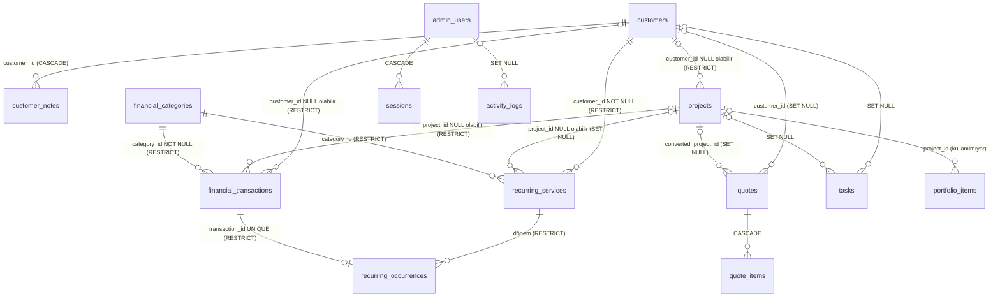

# Kalkan Digital Admin Paneli: Mevcut Durum Analizi

**Kapsam:** `kalkan-digital-next`, salt okuma incelemesi.
**HEAD:** `664b9fa`. Git durumu analizin başında ve sonunda temizdi.

**Yöntem:** Bütün sunucu kodu satır satır okundu: `src/server/**`, Drizzle şeması, migration'lar, admin sayfaları ve ortak bileşenler.

**Çalıştırılan komutlar:**
- `vitest`: 93 geçti, 12 atlandı. Atlananlar `TEST_DATABASE_URL` gerektiren entegrasyon testleri; canlı veritabanına bağlanılmadı.
- `tsc`, `eslint` ve `next build` en son favicon görevinde aynı kod üzerinde temiz geçti. O commit'ten beri kodda değişiklik yok.

**Değiştirilmeyenler:** Hiçbir dosya, veritabanı kaydı, paket veya harici servis.

> **Doğrulanamayanlar:**
> - Gerçek veritabanındaki veri, `.env` değerleri ve Coolify yapılandırması. Projede `.env` dosyası yok; canlı veritabanına bağlanılmadı.
> - Bu yüzden "kaç müşterinin birden fazla sitesi var", "EUR kullanılıyor mu" gibi veri dağılımı soruları **koddan değil, sizden** cevap bekliyor.

---

## 1. Mevcut mimari

### 1.1 Doğrulanmış teknoloji yığını

`package.json` ve `node_modules/next/package.json` ile doğrulandı:

| Katman | Gerçek durum |
|---|---|
| Framework | Next.js **16.4.2**, App Router, `output: "standalone"` (`next.config.ts`) |
| UI | React 19.3, Tailwind CSS v4 (`@tailwindcss/postcss`), lucide-react, recharts |
| Veritabanı | PostgreSQL, sürücü `postgres` (postgres-js) |
| ORM | `drizzle-orm` 0.45 + `drizzle-kit` 0.31 |
| Doğrulama | Zod 4 |
| Test | Vitest 5 (`tests/`); Playwright veya E2E yok |
| Tablo/grid kütüphanesi | **Yok**. Örneğin TanStack Table kurulu değil; tablolar elle yazılmış (`src/components/ui/table.tsx`). |
| UI kit | Yok; kendi bileşenleri: `src/components/ui/*` |

### 1.2 Klasör yapısı (admin ile ilgili)

```
src/
  app/admin/
    page.tsx                  → /admin/dashboard'a yönlendirir
    login/, setup/            → giriş ve ilk kurulum (auth-shell.tsx)
    (panel)/layout.tsx        → requireAdmin() + AdminSidebar + Toast + Flash
    (panel)/{dashboard,customers,projects,transactions,recurring,quotes,tasks,reports,portfolio,settings}/
       page.tsx (liste) · new/page.tsx · [id]/page.tsx (detay) · [id]/edit/page.tsx · *-form.tsx
  components/admin/           → sidebar.tsx (NAV dizisi), filter-bar.tsx, range-filter.tsx, stat.tsx, money.tsx, charts.tsx
  components/ui/              → table.tsx (Table/SortTH), form.tsx (ActionForm, alanlar), confirm-action.tsx, pagination.tsx, badge.tsx, …
  server/
    db/index.ts, db/schema.ts → bağlantı + tek şema dosyası
    actions/*.ts              → "use server" Server Action'ları (tüm yazma işlemleri)
    services/*.ts             → okuma/sorgu katmanı (her fonksiyon önce requireAdmin())
    finance/core.ts           → tüm finansal toplam hesapları
    finance/recurring.ts      → dönem hesabı + tekrar faturalamayı engelleyen dönem kaydı
    auth/*, activity.ts, rate-limit.ts, settings.ts, validation.ts, uploads.ts, env.ts, request.ts, list.ts
  lib/                        → money.ts (BigInt ile kesin ondalık), dates.ts, labels.ts
  proxy.ts                    → /admin/* için iyimser cookie kontrolü (Next 16'da middleware'in yeni adı)
drizzle/                      → 0000_init.sql, 0001_reference_data.sql (+ meta)
scripts/                      → migrate.ts, seed-dev.ts (yalnızca geliştirme ortamı), create-admin.ts
```

### 1.3 Veri katmanı

**Bağlantı:** `src/server/db/index.ts`. Tembel başlatılan bir singleton; `postgres(env().DATABASE_URL, { max: DATABASE_POOL_MAX, prepare: true })`. `db`, bir Proxy üzerinden dışa açılıyor.

**Ortam değişkenleri:** `src/server/env.ts`, Zod ile doğruluyor.
- Zorunlu: `DATABASE_URL`, `SESSION_SECRET` (en az 32 karakter).
- Opsiyonel: `ADMIN_SETUP_TOKEN`.
- `TRUSTED_PROXY_HOPS` doğrulama şemasında yok; `src/server/request.ts` doğrudan `process.env`'den okuyor.

**Desen:**
- Okuma: `services/*.ts`.
- Yazma: `actions/*.ts`; Zod şeması, sonra `parseForm()`, sonra `ActionState` döner.
- Hatalar: PostgreSQL hata kodları Türkçe mesaja çevriliyor (`dbErrorMessage`).
- Listeler: URL parametreleriyle (`?q=&status=&sort=&dir=&page=`) sunucu tarafında filtrelenip sıralanıyor; sayfa boyutu 20 (`server/list.ts`).
- `FilterBar` JavaScript olmadan da çalışan bir GET formu.

**Migration'lar:**
- `0000_init` tüm şemayı kuruyor.
- `0001_reference_data` varsayılan kategorileri ve `base_currency="TRY"` değerini ekliyor; idempotent.
- `docker-entrypoint.sh` migration'ları yalnızca `RUN_MIGRATIONS=true` olduğunda çalıştırıyor; yalnızca ileri yönlü.

### 1.4 Şema (`src/server/db/schema.ts`)

**Enum'lar:**

| Enum | Değerler |
|---|---|
| `admin_role` | owner, admin |
| `customer_type` | company, individual, villa_owner, hotel, agency, other |
| `customer_status` | lead, active, passive |
| `acquisition_source` | 7 değer |
| `note_kind` | call, meeting, email, whatsapp, note |
| `service_type` | web_design, software, villa_rental_software, hotel_tourism_web, hosting_support, digital_ads, social_media, photo_video, other |
| `project_status` | proposal, planned, in_progress, waiting_client, completed, cancelled |
| `currency` | TRY, EUR, USD, GBP |
| `transaction_type` | income, expense |
| `transaction_status` | completed, pending, cancelled |
| `payment_method` | 7 değer |
| `recurring_period` | monthly, quarterly, semiannual, yearly |
| `recurring_status` | active, paused, cancelled |
| `quote_status` | new, contacted, proposal_sent, negotiation, won, lost |
| `quote_source` | manual, website_form |
| `task_priority` | 4 değer |
| `task_status` | todo, in_progress, done, cancelled |

**Tablolar:**
- `admin_users`, `sessions`, `rate_limit_events`, `activity_logs`, `app_settings`
- `customers`, `customer_notes`, `projects`
- `financial_categories`, `financial_transactions`
- `recurring_services`, `recurring_occurrences`
- `quotes`, `quote_items`, `tasks`, `portfolio_items`

### 1.5 Kimlik doğrulama ve yetkilendirme

- **Oturum** (`server/auth/session.ts`): Cookie'de rastgele bir token tutuluyor; veritabanında yalnızca SHA-256 özeti saklanıyor (`sessions.id`). Süre `SESSION_TTL_HOURS`. Cookie: `__Host-` önekli, httpOnly, sameSite=lax.
- **Parola** (`auth/password.ts`): scrypt (N=2^15), en az 12 karakter; büyük harf, küçük harf ve rakam şartı.
- **Giriş** (`actions/auth.ts`): 15 dakikada e-posta başına 5, IP başına 20 deneme sınırı. E-posta yoksa sahte hash ile zamanlama eşitleniyor.
- **`proxy.ts`** yalnızca cookie var mı diye bakıyor. Asıl kontrol her sayfada, Server Action'da ve serviste `requireAdmin()` ile yapılıyor.
- **`tests/authorization.test.ts`:**
  - `actions/` ve `services/` altındaki her dışa açık fonksiyonda **ilk `await`'in `requireAdmin` olmasını** zorunlu kılıyor.
  - Her `(panel)` sayfasında `await requireAdmin()` arıyor.
  - **Yeni kodun da bu kurala uyması gerekecek.**
- **Roller:** `owner` ve `admin`. Yalnızca baz para birimi değişikliği ve yönetici ekleme/pasifleştirme `owner`'a özel; diğer bütün işlemler iki rolde aynı.
- **Güvenlik başlıkları** (`next.config.ts`): HSTS, X-Frame-Options DENY, nosniff; admin altında `no-store` ve `noindex`.

### 1.6 Form doğrulama, hata yönetimi, testler

**`server/validation.ts` (`v.*`):**
- Tutarlar `normalizeDecimalInput` ile Türkçe/uluslararası biçimlerden normalize ediliyor.
- Tarih katı ISO biçiminde (`YYYY-MM-DD`).
- URL'ye `https://` otomatik ekleniyor; telefon ve e-posta regex ile kontrol ediliyor.

**Arayüz:**
- `ActionForm` alan hatalarını gösteriyor.
- `ConfirmAction` silme/arşivleme onayı istiyor.
- Başarı mesajları `?flash=` ile toast olarak çıkıyor.

**Testler:**

| Test dosyası | Kapsam |
|---|---|
| `money.test.ts`, `dates.test.ts` | Birim testleri |
| `authorization.test.ts` | Statik kod taraması |
| `auth.integration.test.ts`, `finance.integration.test.ts` | Gerçek PostgreSQL ister. Yalnızca adında "test" geçen bir veritabanına izin verir ve tabloları `truncate` eder. |

**Not:** Finansal entegrasyon testleri şu an **hiç çalışmıyor**, çünkü test veritabanı yok. Finansal doğruluğun otomatik güvencesi bu yüzden pratikte devre dışı.

---

## 2. Menü envanteri

Her menü için kaynak sayfalar ve fonksiyonlar gerçekten izlendi.

### Genel bakış: `/admin/dashboard`

- **Kaynak:** `dashboard/page.tsx` → `services/dashboard.ts#getDashboard(range)`. `RangeFilter` seçenekleri: bu ay, son 30 gün, bu yıl, önceki yıl, özel.
- **Okuduğu tablolar:** customers, projects, financial_transactions (+categories), recurring_services, tasks, app_settings.
- **Hesapladıkları:**
  - **Sayaçlar:** arşivlenmemiş müşteriler, aktif müşteriler; `in_progress` ve `waiting_client` durumundaki projeler.
  - **Seçili dönem:** `periodTotals` tahsil edilen gelir, ödenen gider ve net tutarı **`settled_date`'e göre** hesaplıyor (nakit esası).
  - **Yıl toplamı:** `range.to`'nun yılı.
  - **Açık kalemler:** `openItems` bekleyen alacak/borcu ve gecikenleri veriyor. Vade, `coalesce(due_date, transaction_date)`.
  - **Grafikler:** aylık seri ve son 5 yıllık seri.
  - **Listeler:** kategorilere göre gelir; son 8 işlem; ödeme beklenen müşteriler (en eski vadeye göre); `renewalWarningDays` içindeki **ve gecikmiş** aktif yenilemeler; 7 gün içindeki açık görevler; son 5 müşteri.
  - **Uyarı:** kuru girilmemiş yabancı para birimli işlemler.
- **Yazma işlemi:** yok.
- **Ana tabloya taşınabilir mi?** KPI şeridi ana tablonun üstüne taşınabilir. Grafikler Raporlar'a taşınabilir.

### Müşteriler: `/admin/customers`

- **Sayfalar:** liste, `new`, `[id]` (detay), `[id]/edit`.
- **Servis** (`services/customers.ts`):
  - `listCustomers`: arama alanları firma, yetkili, e-posta, telefon, WhatsApp. Filtreler: durum, tip, görünüm (aktif/arşiv/tümü). Sıralama: firma, kayıt, durum, ilk iletişim. Her satıra alt sorgularla proje sayısı, **tahsil edilen** ve **bekleyen alacak** ekleniyor.
  - `getCustomerDetail`: projeler (tahsil edilen tutarla birlikte), son 50 işlem, tekrarlayan hizmetler, teklifler, notlar, en fazla 20 görev ve `customerCashSummary`.
- **Yazma** (`actions/customers.ts`):
  - Oluşturma ve güncelleme yinelenen kayıt kontrolüyle: büyük/küçük harf duyarsız aynı firma adı **veya** aynı e-posta reddediliyor.
  - **Arşivleme:** `archivedAt` atanıyor ve `status='passive'` yapılıyor.
  - **Kalıcı silme:** yalnızca bağlı proje, işlem ve tekrarlayan hizmet yoksa. Notlar cascade ile siliniyor; teklif ve görevlerde bağlantı NULL oluyor. Silinen kaydın tam görüntüsü `activity_logs`'a yazılıyor.
  - **Not ekleme/silme:** `customer_notes` (tür, iletişim tarihi, sonraki takip tarihi).
- **Korunması gereken davranışlar:** yinelenen kayıt kontrolü; silme yerine arşiv politikası; aktivite kaydı.
- **Ana tabloya taşınabilir mi? Evet, ana tablonun omurgası olmaya en uygun modül bu.**

### Projeler: `/admin/projects`

- **Sayfalar:** liste, `new` (`?customerId=` ile ön seçim), `[id]`, `[id]/edit`.
- **`listProjects`:**
  - Ödeme durumu filtresi: not_set, unpaid, partial, paid.
  - "Tahsil edilen" `projectCollectedExpr` ile hesaplanıyor: proje para birimi baz para birimiyse `base_amount`, değilse **yalnızca aynı para birimindeki** gelirler.
- **Detay:**
  - Ödeme durumu ve kalan tutar: anlaşılan tutar − tahsil edilen.
  - Tahmini kâr: `agreed − estimated_cost`; maliyet boşsa 0 sayılıyor.
  - Nakit sonucu: tahsil edilen − ödenen gider (bağlı işlemler, baz para birimi).
  - Bağlı işlemler ve görevler.
- **Yazma** (`actions/projects.ts`):
  - Oluşturma ve güncelleme. Tarih tutarlılığı kontrol ediliyor: hedef ve teslim tarihi başlangıçtan önce olamaz.
  - Proje başka müşterinin işlemlerine bağlıysa müşteri değiştirilemiyor (bkz. §4'teki istisna).
  - Arşivleme.
  - Silme yalnızca bağlı finansal işlem yoksa mümkün.
- **Ana tabloya taşınabilir mi?** Evet, müşteri satırının alt satırları veya detay panelinin "Siteler/Projeler" sekmesi olarak.

### Gelir & gider: `/admin/transactions`

- **Liste filtreleri:** metin araması (açıklama, belge no, notlar), tip, durum (+ `overdue`), para birimi, ödeme yöntemi, kategori, müşteri, proje, tarih alanı (işlem/tahsil/vade) ve aralık.
- **Liste özeti:** filtreye uyan kayıtların tahsil edilen, alacak, ödenen ve borç toplamları.
- **Yazma** (`actions/transactions.ts`):
  - **Oluşturma ve güncelleme:**
    - Kategori tipi işlem tipiyle uyuşmalı.
    - Proje başka müşteriye aitse kayıt reddediliyor.
    - Müşteri boşsa projeden dolduruluyor.
    - `completed` kayıt gelecek tarihli olamaz; tahsil tarihi boşsa işlem tarihi kullanılıyor.
    - Baz para birimi karşılığı `computeBaseValues` ile hesaplanıyor; kur yoksa `base_amount = NULL`.
    - Güncellemede eski baz para birimi korunuyor ve alan bazlı değişiklik farkı loglanıyor.
    - `returnTo` parametresi destekleniyor; mevcut koddaki tek örnek bu.
  - **`settleTransactionAction`:** `pending` kaydı `completed` yapıp tahsil tarihini atıyor (atomik `WHERE status='pending'`).
  - **Silme:** tekrarlayan hizmetten doğan işlem silinemiyor (iptal edilmesi isteniyor); diğerleri silinebiliyor, görüntüsü loglanıyor.
  - **Kategori CRUD:** kullanımdaki kategori silinemiyor, pasif yapılıyor.
- **Ana tabloya taşınabilir mi?** **Kısmen.** Müşteriye bağlı kayıtlar detay panelinde gösterilebilir. Müşteriye bağlı olmayan giderler (yazılım abonelikleri, vergi, donanım) ve genel muhasebe defteri için **ayrı ekran kalmalı.**

### Yenilemeler: `/admin/recurring`

- **Tablo:** `recurring_services`. `customer_id` **zorunlu**, `project_id` opsiyonel, kategori gelir tipinde olmalı. Diğer alanlar: tutar, para birimi, periyot, başlangıç, `next_renewal_date`, durum, `auto_renew` (yalnızca bilgi amaçlı), `payment_term_days`.
- **Liste:**
  - Filtreler: gecikmiş (`next_renewal_date < bugün`) ve yaklaşan (≤ `renewalWarningDays`).
  - Satır bilgileri: son tahsil tarihi, açık dönem sayısı.
  - Ayrıca "ödemesi gecikmiş faturalanmış dönemler" listesi.
- **Yazma:**
  - Oluşturma ve güncelleme. Sonraki yenileme tarihi, faturalanmış son dönemin öncesine çekilemiyor.
  - **`billRecurringAction` / `billNextPeriod`:**
    1. Satır `FOR UPDATE` ile kilitleniyor.
    2. **`pending`** bir gelir işlemi oluşturuluyor; vade = dönem başı + ödeme vadesi (gün).
    3. Dönem kaydı (`recurring_occurrences`) ekleniyor; servis+dönem ve işlem üzerinde unique kısıt var, aynı dönem iki kez faturalanamıyor.
    4. `next_renewal_date` bir periyot ileri alınıyor.
  - **`billAllDueAction`:** vadesi gelmiş bütün dönemleri, hizmet başına en fazla 36 dönem olmak üzere faturalıyor.
  - **Silme:** faturalanmış dönemi varsa engelleniyor.
- **İş kuralı:** faturalanan dönem **gelir sayılmıyor**, yalnızca beklenen tahsilattır; tahsil edildiğinde gelire geçiyor.
- **Ana tabloya taşınabilir mi?** Evet: "Sonraki yenileme" ve "Yıllık tekrarlayan tutar" kolonları ile detayda "Hizmetler & yenilemeler" bölümü. **Toplu faturalama** (`billAllDue`) için global bir eylem gerekli; ayrı bir "Yenileme takvimi" görünümü olarak kalabilir.

### Teklifler: `/admin/quotes`

- **Tablolar:** `quotes`, `quote_items`.
  - `customer_id` opsiyonel.
  - Firma, yetkili, telefon ve e-posta teklifin **kendi kolonlarında** tutuluyor; potansiyel müşteri henüz müşteri kaydı değilken de teklif oluşturulabilsin diye.
- **Web formu** (`actions/public.ts#submitContactAction`, kimlik doğrulama yok):
  - Bal küpü alanı, en az 2,5 sn form doldurma süresi, saatte IP başına 5 gönderim ve onay kutusu zorunlu.
  - Yalnızca `quotes` tablosuna `website_form` kaydı ekliyor.
- **Yazma:**
  - Oluşturma, güncelleme, durum değişikliği, silme. Silmede kalemler cascade ile gidiyor.
  - Kalem ekleme/silme `estimated_amount`'u kalem toplamıyla **senkronize ediyor**.
  - **`convertQuoteAction`**, tek bir veritabanı transaction'ı içinde:
    - mevcut müşteriyi seçiyor (onu aktif yapıp arşivden çıkarıyor) **veya** yeni müşteri oluşturuyor;
    - projeyi `planned` durumunda, teklif tutarıyla oluşturuyor;
    - teklifi `won` yapıyor. Finansal işlem oluşturmuyor.
  - `findCustomerMatches`: isim, e-posta veya telefonun son 10 hanesiyle olası yinelenen müşterileri öneriyor.
- **Ana tabloya taşınabilir mi?** **Müşteriye bağlı teklifler** detay panelinde gösterilebilir. **Müşterisiz potansiyel müşteriler** (web formu) müşteri satırında görünmez; **ayrı bir satış süreci (pipeline) görünümü kalmalı** ya da ana tabloda ayrı bir sekme olmalı.

### Görevler: `/admin/tasks`

- **Tablo:** `tasks`.
  - Müşteri ve proje opsiyonel. `due_at` ve `remind_at` `timestamptz`; formda İstanbul yerel saati olarak giriliyor.
  - Hatırlatma **gönderen bir mekanizma yok**; `remind_at` yalnızca saklanıyor.
- **Liste:** varsayılan "açık" filtresi; vade filtreleri gecikmiş, bugün, bu hafta, vadesiz.
- **Yazma:**
  - Oluşturma ve güncelleme; müşteri boşsa projeden dolduruluyor.
  - Tamamlandı işaretleme `completed_at`'i yönetiyor.
  - Hızlı tamamlandı/yeniden aç düğmesi.
  - Silme (görüntüsü loglanıyor).
- **Ana tabloya taşınabilir mi?** Evet: "Açık görev" sayacı ve detay sekmesi. Günlük iş listesi olarak "Bugün" filtresi ayrıca faydalı.

### Raporlar: `/admin/reports`

- **Kaynak:** `services/reports.ts#getYearReport(year, compareYear)`.
- **İçerik:**
  - Yıl ve karşılaştırma yılı toplamları, aylık seriler, gelir ve gider kategorileri.
  - **Para birimine göre özgün tutarlar.** Farklı para birimleri toplanmıyor.
  - Açık alacak ve borçlar, alacak yaşlandırma (vadesi gelmemiş, 0–30, 31–90, 90+).
  - Proje kârlılığı: iptal edilmemiş son 50 proje.
- **Yazma işlemi:** yok.
- **Ana tabloya taşınabilir mi?** **Ayrı kalmalı.** Dönem bazlı analizi satır bazlı tabloya sığdırmak doğru değil.

### Portfolyo: `/admin/portfolio`

- **Tablo:** `portfolio_items`. Herkese açık sitedeki `/projeler` ve ana sayfa vitrini.
- **Yazma:**
  - Benzersiz slug üretimi.
  - Görsel yükleme: dosyanın gerçek imzası kontrol ediliyor (PNG/JPEG/WebP), en fazla 5 MB; `UPLOAD_DIR`'e yazılıyor ve `/media/...` route'undan sunuluyor.
  - Yayın ve öne çıkarma.
- **Not:** Şemada `project_id` var ama **form bu alanı hiç doldurmuyor**; bağlantı kullanılmıyor.
- **Ana tabloya taşınabilir mi?** **Ayrı kalmalı.** Bu bölüm işletme verisi değil, web sitesi içeriği.

### Ayarlar: `/admin/settings`

- **`app_settings.company`:** firma adı, e-posta, telefon, WhatsApp, adres, vergi bilgisi, `renewalWarningDays` (1–180). Bu değerler herkese açık sitede de kullanılıyor (`server/public.ts`).
- **`base_currency`:** **yalnızca hiç finansal işlem yokken** ve yalnızca owner değiştirebilir.
- **Hesap işlemleri:** parola değiştirme (diğer oturumları kapatıyor), diğer oturumları kapatma, yönetici ekleme ve pasifleştirme (owner).
- **Alt sayfalar:** kategoriler; aktivite kaydı (salt okunur, sayfa başına 40 kayıt).
- **Ana tabloya taşınabilir mi?** **Ayrı kalmalı.**

---

## 3. Veri ilişkileri

### 3.1 ER diyagramı (yalnızca mevcut foreign key'ler)



`activity_logs.entity_type` + `entity_id` serbest metin; foreign key değil.

### 3.2 Sorularınızın yanıtları

| Soru | Koddan bulgu |
|---|---|
| Bir müşterinin birden fazla sitesi veya projesi olabilir mi? | **Evet.** `projects.customer_id` çoktan-bire. **"Site" adlı bir varlık yok.** En yakın karşılık: `projects` (`project_type`, `project_url`) ve `customers.website` (tek URL). |
| Bir site birden fazla hizmete, sunucuya veya yenilemeye bağlanabilir mi? | Bir projeye birden fazla `recurring_services` bağlanabilir (`project_id`). Ancak bağlantı **opsiyonel**; hizmet yalnızca müşteriye bağlı da olabilir. **Sunucu kavramı yok.** |
| Müşteri, proje ve site tanımı | Müşteri: `customers`. Proje: iş/teslim kalemi; teklif, anlaşma, maliyet ve durum içeriyor. Site: ayrı bir kavram değil; projedeki URL alanından ibaret. |
| Gelir ve gider kayıtları neye bağlı? | `customer_id` ve `project_id` ikisi de opsiyonel; `category_id` zorunlu. Tekrarlayan hizmetten doğan kayıtlar `recurring_occurrences` üzerinden hizmete bağlı. |
| Teklif, görev ve yenilemeler müşteri veya projeyle ilişkili mi? | Teklif: müşteri opsiyonel; projeye yalnızca dönüştürüldüğünde bağlanıyor (`converted_project_id`). Görev: müşteri ve proje opsiyonel. Yenileme: müşteri **zorunlu**, proje opsiyonel. |
| Yıllık/aylık maliyet ve tahsilat tutarları nerede? | Tekrarlayan gelir: `recurring_services.amount` + `period`. **Yıllıklaştırılmış tutar hiçbir yerde hesaplanmıyor.** Proje: `quoted_amount`, `agreed_amount`, `estimated_cost`. Gerçekleşen: `financial_transactions`. **Tekrarlayan *maliyet* (bizim ödediğimiz hosting/domain) için yapı yok.** Bunlar yalnızca tek tek gider kaydı olarak girilebiliyor. |
| Para birimi ve dönüşüm | Her kayıtta özgün `currency` var. İşlemlerde `exchange_rate` **elle giriliyor**; otomatik kur çekme yok. `base_amount = amount × rate`, BigInt ile yarım değer sıfırdan uzağa yuvarlanıyor. `base_currency` işlem anındaki değerin kopyası. Kur yoksa `base_amount` NULL ve toplamlara **girmiyor**; ayrıca sayılıp uyarı gösteriliyor. Teklif, proje ve yenileme tutarları yalnızca özgün para biriminde tutuluyor. |
| Tarih biçimi ve saat dilimi | İş tarihleri PostgreSQL `date` (mode: string, `YYYY-MM-DD`), saat dilimsiz. "Bugün" Europe/Istanbul'a göre (`lib/dates.ts#todayIso`). Zaman damgaları `timestamptz`. Görev saatleri sabit +03:00 varsayımıyla çevriliyor (`istanbulLocalToDate`). |
| Aynı bilginin tekrarlandığı yerler | Bkz. §4.2. |
| Silme, arşiv ve geçmiş | Arşiv: `customers.archived_at`, `projects.archived_at`; `quotes.archived_at` var ama **onu set eden bir işlem yok**. Finansal geçmişi olan kayıtlar silinemiyor (RESTRICT + uygulama kontrolleri). Çoğu silme işleminde kaydın tam görüntüsü `activity_logs.details.snapshot`'a yazılıyor. Güncellemelerde alan bazlı fark **yalnızca işlemlerde** tutuluyor; müşteri, proje ve teklif güncellemeleri yalnızca "güncellendi" özeti bırakıyor. |

---

## 4. Mevcut sorunlar

### 4.1 Doğrulanmış teknik riskler (bu aşamada düzeltilmedi)

| # | Risk | Kanıt | Etki |
|---|---|---|---|
| R1 | Projesi müşterisizken işlem eklenip proje sonradan müşteriye atanırsa eski işlemlerin `customer_id`'si NULL kalıyor. Proje güncellemesindeki kontrol yalnızca `before.customerId` doluysa çalışıyor. | `actions/projects.ts#updateProjectAction`, `if (before.customerId && …)` | Müşteri bazlı toplamlar (liste, detay, gelecekteki ana tablo) bu işlemleri **eksik gösterir**. |
| R2 | Proje müşterisi değişirken o projeye bağlı `recurring_services` kayıtlarının müşterisi kontrol edilmiyor. | Aynı fonksiyon, yalnızca `financial_transactions` sayılıyor. | Hizmet A müşterisinde, projesi B müşterisinde kalabilir. |
| R3 | Tekrarlayan hizmetin `customer_id` / `project_id` alanı, faturalanmış dönemleri varken değiştirilebiliyor. | `actions/recurring.ts#updateRecurringAction`, yalnızca tarih kontrolü var. | Geçmiş dönem işlemleri eski müşteride kalır; hizmet yeni müşteride görünür. |
| R4 | Tekrarlayan hizmetten doğan işlemde yalnızca **tip** kilitli; tutar, müşteri, proje ve tarihler serbestçe düzenlenebiliyor. | `actions/transactions.ts#updateTransactionAction` | Dönem kaydıyla işlem birbirinden kopabilir. |
| R5 | Görevde, seçilen müşteriyle projenin müşterisinin uyumu kontrol edilmiyor (işlemlerde ediliyor). | `actions/tasks.ts#normalize` | Görev yanlış müşterinin altında görünebilir. |
| R6 | Müşteri arşivlenince aktif hizmetleri `active` kalıyor. | `setCustomerArchivedAction`; `dueServiceIds` müşteri arşivini filtrelemiyor. | "Tümünü faturala" arşivlenmiş müşteriye beklenen tahsilat oluşturur; dashboard'da yenileme olarak görünmeye devam eder. |
| R7 | Yabancı para birimli hizmet faturalandığında kur `null` geçiliyor; işlemi "tahsil edildi" yapmak kur girmeyi istemiyor. | `finance/recurring.ts` (`exchangeRate: null`), `settleTransactionAction` | Örneğin EUR hosting tahsilatları, kayıt düzenlenip kur girilene kadar TRY gelir toplamlarına **hiç girmez** (uyarıyla). |
| R8 | Raporlardaki proje tablosu yıla göre filtrelenmiyor ve 50 projeyle sınırlı. `collectedBase`, `expenseBase` ve `receivableBase` alt sorgularında `base_currency` filtresi yok. | `services/reports.ts#getYearReport` | Yıllık raporda proje rakamları **tüm zamanları** gösterir. Baz para birimi işlem varken değiştirilemediği için (`setBaseCurrencyAction`) para birimi karışması pratikte olmaz. |
| R9 | Tutar doğrulaması 13 basamaklı tam sayıları kabul ediyor; `numeric(14,2)` en fazla 12 tam basamak alıyor. | `validation.ts` (`length > 14`) | Böyle bir girişte kullanıcı genel bir "beklenmeyen hata" mesajı görür. Düşük risk. |
| R10 | Tahsil tarihi işlem tarihinden önce olabiliyor; kontrol yok. | `settleTransactionAction`, `txSchema` | Düşük risk, veri tutarlılığı sorunu. |
| R11 | Teklif `won` durumuna dönüştürme işlemi olmadan da alınabiliyor (`updateQuoteAction` / `setQuoteStatusAction`). | `actions/quotes.ts` | "Kazanıldı ama projesi yok" teklifler oluşabilir. |
| R12 | `quotes.archived_at` ve `portfolio_items.project_id` alanlarını kullanan bir arayüz veya işlem yok; ölü alanlar. | grep sonucu | Karmaşıklık. |
| R13 | Finansal entegrasyon testleri test veritabanı olmadığı için çalışmıyor. | `tests/helpers.ts`, `describe.skipIf(!hasTestDb)` | Finansal regresyonlar otomatik yakalanmaz. |

### 4.2 Tekrar eden bilgiler

| Bilgi | Nerede tekrarlanıyor | Değerlendirme |
|---|---|---|
| Firma/kişi iletişim bilgileri | `customers` ve `quotes` (company_name, contact_name, phone, email) | **Bilinçli.** Potansiyel müşteri henüz müşteri değil. Dönüştürmede teklifteki veri müşteriye kopyalanıyor, sonra ikisi ayrı yaşıyor. |
| Web adresi | `customers.website`, `projects.project_url`, `portfolio_items.live_url` | Gerçek tekrar. Ana tabloda tek "site" kolonu için kaynağın seçilmesi gerekiyor (bkz. §12). |
| Müşteri adı | `portfolio_items.client_name` (serbest metin) | Vitrin için bilinçli. |
| Tutar | `recurring_services.amount` → her dönemin `financial_transactions.amount` alanı | **Bilinçli kopya.** Fiyat değişse de geçmiş dönem değişmemeli. |
| Teklif tutarı | `quotes.estimated_amount` = kalem toplamı (otomatik senkron) ve elle girilebilir | Elle girilen değer, kalem eklenince ezilir. |
| İşlemlerde müşteri ve proje | `financial_transactions` hem `customer_id` hem `project_id` tutuyor | Gerekli, ama R1'deki tutarsızlığa açık. **Ana tabloda müşteri toplamı yalnızca `customer_id` üzerinden alınmalı; proje toplamlarıyla toplanmamalı** (çift sayım riski). |

### 4.3 Kullanıcı deneyimi sorunları (hedefinize göre)

- Bir müşterinin resmi için 4–5 ekran gerekiyor: müşteri detayı, proje, yenileme, işlem, görev. Müşteri detayı birçok bilgiyi topluyor, ama düzenleme her seferinde ayrı sayfaya gidiyor.
- Bütün formlar kaydettikten sonra kendi detay sayfasına yönleniyor; `returnTo` yalnızca işlem oluşturmada var. Bu yüzden detay panelinden düzenleme yapınca kullanıcı panelden çıkıyor.
- Tablolar 640 px minimum genişlikle yatay kayıyor; mobil için kart görünümü yok. Kolon seçme, sabit başlık ve sabit ilk kolon yok.
- "Yıllık tekrarlayan gelir", "bu müşteriden yıllık beklenen" gibi işletme göstergeleri hiçbir ekranda yok.
- Teknik altyapı bilgisi (domain bitişi, hosting, DNS) için yapılandırılmış alan yok; yalnızca hizmet adı ve notlar.

### 4.4 Teknik ve operasyonel alanların durumu

| Alan | Mevcut mu? | Nerede |
|---|---|---|
| Firma ve müşteri iletişim bilgileri | **Var** | `customers.*` (firma, yetkili, telefon, WhatsApp, e-posta, web, adres). Kendi firma bilgileri: `app_settings.company`. |
| Domain adı ve bitiş tarihi | **Yok** (yapılandırılmış alan olarak) | Dolaylı olarak bir `recurring_services` satırı (ad: "ornek.com domain", `next_renewal_date`). Hizmet tipi alanı yok; yalnızca gelir kategorisi ("Domain", "Hosting"). |
| Hosting sağlayıcısı, sunucu bilgileri | **Yok** | Yalnızca serbest metin notlar. |
| Cloudflare, DNS, SSL durumu | **Yok** | Hiçbir dosyada yok. |
| Depolama, yedekleme, mail hizmeti | **Yok** | Yalnızca pazarlama metinlerinde geçiyor (`lib/content.ts`). |
| Aylık/yıllık hizmet **maliyeti** (bizim ödediğimiz) | **Yok** | Yalnızca tek tek gider kayıtları. Tekrarlayan gider yapısı yok. |
| Müşteriye kesilen/teklif edilen tutar | **Var** | `projects.quoted_amount`/`agreed_amount`, `quotes.estimated_amount`/`quote_items`, `recurring_services.amount`. Fatura numarası: `financial_transactions.document_no`. **Fatura belgesi yok.** |
| Tahsilat durumu, bekleyen ödemeler | **Var** | `financial_transactions.status` + `due_date` + `settled_date`. |
| Bakım anlaşmaları, yenileme tarihleri | **Var** (genel) | `recurring_services` (periyot, `next_renewal_date`, `payment_term_days`, `auto_renew`). |
| Durum, notlar, işlem geçmişi | **Var** | Her tabloda `status`; notlar: `customer_notes` (müşteri düzeyi) ve `*.notes` / `internal_notes`; geçmiş: `activity_logs`. |

### 4.5 Güvenlik gözlemleri (değerler yazılmadı)

- **Parola özeti:** `admin_users.password_hash` (scrypt).
- **Oturumlar:** `sessions.id` token'ın SHA-256 özeti; ham token saklanmıyor.
- **IP adresi:** `sessions.ip_address` ve `activity_logs.ip_address` **açık metin** saklanıyor. `rate_limit_events` ise HMAC ile özetliyor. KVKK açısından not edilmeli.
- **Başarısız girişler:** yazılan e-posta adresi `activity_logs.summary`'ye yazılıyor.
- **Sırlar:** yalnızca ortam değişkenlerinde (`DATABASE_URL`, `SESSION_SECRET`, `ADMIN_SETUP_TOKEN`). Repoda `.env` yok; `.env.example` yalnızca yer tutucu içeriyor.
- **Uygulamada sunucu/panel parolası, SSH veya API anahtarı tutan alan yok.** Teknik altyapı alanları eklenirse **kimlik bilgilerinin bu uygulamada saklanmaması** önerilir; bir parola yöneticisine referans verilebilir. Aksi halde serbest metin not alanları sızıntı riski taşır.

---

## 5. Önerilen ana tablo

### 5.1 Satır neyi temsil etmeli?

| Seçenek | Mevcut modele uygunluk | Sorun |
|---|---|---|
| **A. Müşteri** | **En yüksek.** Bütün modüllerde ortak olan tek anahtar `customer_id`. Yenilemelerde NOT NULL; işlemler, teklifler ve görevler de çoğunlukla müşteriye bağlı. | Birden çok site tek satırda özetlenir. |
| B. Proje ("site") | Orta. | `recurring_services.project_id` ve `financial_transactions.project_id` opsiyonel. Projeye bağlanmamış hizmet ve tahsilatlar ana tablodan **kaybolur**. Projesi olmayan müşteri görünmez. Bir müşterinin birkaç projesi varsa müşteri iletişim bilgileri her satırda tekrar eder. |
| C. Yenileme/hizmet | Düşük. | Hizmeti olmayan müşteriler ve projeler görünmez. |

**Öneri: satır = müşteri.** Satır genişletildiğinde müşterinin projeleri alt satır olarak görünür (site URL'si, durum, sonraki yenileme). Ek olarak "Projeye bağlanmamış hizmetler" grubu gösterilir.

Bu yaklaşım şema değişikliği gerektirmiyor. İleride "site" ayrı bir varlık olursa alt satırlar o tabloya geçer; yapı bozulmaz.

Müşteri ve site bilgisinin tek tabloda gösterilmesi mevcut modele uygun. Ancak alt satırlar müşteriye `projects.customer_id` üzerinden bağlanır; **müşterisiz projeler** (customer_id NULL) için ayrı bir "Müşterisiz" filtresi veya grubu gerekir.

### 5.2 Varsayılan kolonlar (her biri mevcut veriden)

| Kolon | Kaynak / hesap |
|---|---|
| Müşteri (firma + yetkili) | `customers.company_name`, `contact_name` |
| Durum | `customers.status` (+ arşiv rozeti) |
| İletişim (simgeler: ara/WhatsApp/e-posta) | `phone`, `whatsapp`, `email` |
| Siteler/projeler (sayı + birincil URL) | `count(projects)`. URL kaynağı karar gerektiriyor; bkz. §12. |
| Sonraki yenileme (tarih + hizmet adı, gecikmişse kırmızı) | aktif `recurring_services` içinde `min(next_renewal_date)` |
| Yıllık tekrarlayan gelir | aktif hizmetlerde `amount × 12 / PERIOD_MONTHS[period]`. **Yeni bir hesap**; para birimi başına ayrı gösterilmeli ("₺6.000 + €120"), çünkü kur yok. |
| Bekleyen alacak (gecikmiş kısmı vurgulu) | `pending` gelirler, `customer_id` bazında (mevcut `openItems` mantığıyla aynı vade kuralı) |
| Son tahsilat | `max(settled_date)`, tamamlanmış gelir |
| Açık görev / açık teklif | sayaçlar |

### 5.3 İsteğe bağlı kolonlar (kolon seçici veya yatay kaydırma)

Tip, kaynak, ilk iletişim, e-posta/telefon metni, toplam tahsilat (tüm zamanlar, `customerCashSummary.collected`), bu yıl tahsilat, ödenen gider (müşteriye bağlı), aktif hizmet sayısı, son not tarihi ve sonraki takip (`customer_notes.next_follow_up_date`), kayıt tarihi.

### 5.4 Arama, filtre, sıralama, hızlı ekleme

**Arama:** mevcut müşteri alanları (firma, yetkili, e-posta, telefon, WhatsApp), artı `EXISTS` ile proje adı, `project_url` ve hizmet adı. Böylece "ornek.com" araması doğru müşteriyi bulur.

**Filtreler:**
- Durum, tip, görünüm (aktif/arşiv/tümü).
- "Yenilemesi X gün içinde" (`renewalWarningDays`).
- "Gecikmiş yenileme", "Gecikmiş alacak var", "Açık görevi var".
- Para birimi.
- "Müşterisiz projeler".

**Sıralama ve sayfalama:** Sunucu tarafında, mevcut `SortTH` / `?sort=` deseniyle; sıralama hesaplanmış SQL ifadelerine göre yapılabilir. Sayfa boyutu 20'den 50'ye çıkarılabilir.

**Neden sunucu tarafı:** Mevcut desenle uyumlu, JavaScript olmadan da çalışır, yetkilendirme testine uyar. Tablo kütüphanesi eklenmez; eklenecekse ayrı onay gerekir.

**Hızlı ekleme:** Üst çubukta "+ Müşteri" (modal veya drawer; mevcut `CustomerForm` ve `createCustomerAction`, yinelenen kayıt kontrolüyle). Satır menüsünde "+ Proje / + Hizmet / + Tahsilat / + Görev / + Not"; müşteri ön seçili gelir (mevcut `?customerId=` desteği).

**Boş, eksik ve çelişkili veri:**
- Boş değer "—" olarak gösterilir.
- Kuru eksik işlem varsa hücrede uyarı simgesi ve "kur eksik (n)" gösterilir (mevcut `missingRate` mantığı).
- Arşivli müşteride aktif hizmet varsa uyarı rozeti (R6).
- R1/R3 tipi tutarsızlıklar için bir "Veri kontrolü" filtresi düşünülebilir (yalnızca okuma).

---

## 6. Önerilen detay paneli

**Açılma biçimi:** Masaüstünde sağdan açılan panel, mobilde tam ekran sayfa. URL'de `?open=<customerId>&tab=<sekme>` tutulur. Panel sunucuda `getCustomerDetail` ile oluşturulur; bağlantı paylaşılabilir ve geri tuşu çalışır.

| Sekme | Veri kaynağı (mevcut) | Eksik ilişki/alan | Düzenleme yöntemi |
|---|---|---|---|
| Genel | `customers.*`, `customerCashSummary` | — | Mevcut `updateCustomerAction`. Panele geri dönülebilmesi için `returnTo` desteği gerekir; şu an redirect `/admin/customers/[id]`'ye gidiyor. Arşivleme, silme ve onay pencereleri aynen kalır. |
| Siteler & projeler | `getCustomerDetail.projects` (+ `projectCollectedExpr`, `paymentStatusOf`) | "Site" varlığı yok; teknik bilgi yok | Mevcut proje formu ve işlemleri. R1/R2 riskleri düzeltilmeden müşteri değiştirme panelden açılmamalı. |
| Teknik hizmetler | **Kaynak yok.** Ancak `recurring_services` adı ve kategorisi ile kısmen gösterilebilir. | Domain, hosting, DNS, SSL, yedek, mail alanları | Şema genişletmesi gerekir (onay ister). O zamana kadar bu bölüm hizmetler ve notlardan oluşur. |
| Hizmetler & yenilemeler | `getCustomerDetail.recurring` + dönemler (`getRecurringDetail.occurrences`) | Tekrarlayan maliyet (gider) yok | Mevcut tekrarlayan hizmet formu; "Bu dönemi faturala" (`billRecurringAction`, `periodStart` ile çift tıklama korumalı). |
| Gelir, gider, tahsilat | `getCustomerDetail.transactions` (son 50) | — | Mevcut işlem formu (`returnTo` var). "Tahsil edildi" düğmesi (`settleTransactionAction`). Yabancı para birimli kayıtta kur sorulmalı (R7). |
| Teklifler & görevler | `quotes` (customer_id), `tasks` (en fazla 20) | Projeye bağlı ama müşterisi NULL görevler gösterilmez | Mevcut formlar; görev tamamlama düğmesi (`toggleTaskDoneAction`). |
| Notlar & geçmiş | `customer_notes`; `activity_logs` (`entity_type='customer'` ve `entity_id`) | Müşteriye ait proje ve işlem logları `entity_id` ile doğrudan bağlı değil; ancak sorguyla birleştirilebilir | Not ekleme/silme mevcut. Geçmiş salt okunur. |

**Doğrulamalar:** Bütün yazma işlemleri mevcut Server Action'lardan ve Zod şemalarından geçmeli; yeni doğrulama yolu açılmamalı.

**Hücre içi düzenleme (Excel benzeri):**
- Yalnızca güvenli alanlarda: müşteri durumu, telefon, yetkili, sonraki takip tarihi.
- Finansal alanlarda (tutar, para birimi, kur, durum) yapılmamalı; her zaman tam form ve onay kullanılmalı.

---

## 7. Menü sadeleştirme planı

| Menü | Öneri | Gerekçe |
|---|---|---|
| Müşteriler | **Ana ekran olur** ("İşletme tablosu") | Satır modeli. |
| Projeler | Ana tablo + detay paneli | Global proje listesi (durum ve teslim takibi) ana tablonun bir görünüm sekmesi veya filtresi olarak kalabilir. |
| Yenilemeler | Kolon + detay sekmesi. **"Vadesi gelenleri faturala"** global eylemi ana tablonun üst çubuğuna taşınır. | `billAllDueAction` müşteri bağımsız bir toplu işlem. |
| Görevler | Kolon + detay sekmesi + üst çubukta "Bugün" çekmecesi | Müşterisiz görevler de var; global liste erişilebilir kalmalı. |
| Genel bakış | KPI şeridi ana tablonun üstüne. Grafikler Raporlar'a. | Rakamlar aynı `finance/core` fonksiyonlarından gelmeli. |
| Teklifler | **Ayrı kalmalı** (veya "Potansiyel müşteriler" sekmesi) | Web formundan gelen müşterisiz kayıtlar ve dönüştürme akışı. |
| Gelir & gider | **Ayrı kalmalı** (muhasebe defteri) | Müşteriye bağlı olmayan giderler; filtreli toplamlar; kategori yönetimi. |
| Raporlar | **Ayrı** | Dönem ve yıl analizi. |
| Portfolyo | **Ayrı** | Herkese açık site içeriği. |
| Ayarlar | **Ayrı** | Firma, para birimi, güvenlik, yöneticiler, kategoriler, aktivite kaydı. |

**Sonuç:** 10 menü 6'ya iner: İşletme tablosu, Teklifler, Gelir & gider, Raporlar, Portfolyo, Ayarlar. Eski sayfalar bir süre adresleriyle erişilebilir kalmalı; hemen silinmemeli.

---

## 8. Veri bütünlüğü riskleri

### 8.1 Doğrulanan kurallar (korunmalı)

- **Kavramlar ayrı:**
  - **Tahsil edilen gelir:** `income` + `completed`, `settled_date`'e göre.
  - **Alacak:** `income` + `pending`; gelir sayılmıyor.
  - **Ödenen gider:** `expense` + `completed`.
  - **Borç:** `expense` + `pending`.
  - **İptal edilenler:** her toplamdan hariç.
  - Kaynak: `finance/core.ts` başlık yorumu ve sorgular.
- **Dashboard rakamları:** `periodTotals`, `openItems`, `monthlySeries`, `yearlySeries`, `totalsByCategory`. Dönemler kapsayıcı (`gte`/`lte`), takvim ayı ve yılı doğru (`resolveRange`, `daysInMonth`). Yıllık toplam `range.to` tarihinin yılını kullanıyor.
- **Para birimleri asla toplanmıyor;** kuru olmayan kayıtlar baz para birimi toplamına girmiyor (`missingRate`).
- **Veritabanı kısıtları:** pozitif tutar; `completed` ise `settled_date` zorunlu; baz tutar ile kur tutarlılığı; dönem başına tek faturalama; tek işlem başına tek dönem.
- **Çift sayım:** Toplamlar alt sorgu ve `GROUP BY` ile yapılıyor; satırları çoğaltan JOIN'li toplama görülmedi. **Risk yeni kodda:** müşteri satırında projelerin tahsilatı müşteri toplamına **eklenmemeli**. Aynı işlem iki bağlantıda da sayılır.
- **Proje ödeme durumu:** proje para birimi baz para biriminden farklıysa, başka para birimindeki tahsilat sayılmıyor. Örneğin EUR proje TRY ile ödenirse "ödenmedi" görünür. Bilinçli bir tasarım, ama ana tabloda açıklanmalı.
- **Yenileme tutarı:** dönem faturalanırken hizmetin **o anki** tutarı kopyalanıyor. Fiyat değişikliği geçmişi etkilemiyor. Vade = dönem başı + `payment_term_days`.

### 8.2 Senaryolar

| Senaryo | Mevcut davranış |
|---|---|
| Müşteri silme | Projesi, işlemi veya hizmeti varsa engelleniyor. Notlar siliniyor; teklif ve görev bağlantısı NULL oluyor. |
| Proje silme | İşlemi varsa engelleniyor. Hizmet, görev, teklif ve portfolyo bağlantısı NULL oluyor. Hizmetin projesi sessizce kopuyor. |
| İşlem silme | Dönem kaydına bağlıysa engelleniyor; değilse kalıcı siliniyor (görüntüsü loglanıyor). |
| İşlem iptali | Durum `cancelled`; toplamlardan düşüyor. Dönem kaydı kalıyor, dolayısıyla o dönem **yeniden faturalanamaz** (unique). İptal edilen dönem için yeni işlem gerekirse elle eklenmeli. |
| Hizmet fiyat değişikliği | Yalnızca gelecek dönemler etkileniyor. |
| Arşivleme | Müşteri ve proje listelerden gizleniyor; finansal toplamlar arşivden bağımsız (tüm kayıtlar sayılıyor). Hizmetler aktif kalıyor (R6). |

---

## 9. Uygulama aşamaları

Her aşama ayrı commit'lenebilir ve geri alınabilir. Aşama 0–4 şema değiştirmez.

0. **Hazırlık.** Kararlar (§12) alınır. Ayrılmış bir **test veritabanı** ile entegrasyon testleri çalışır hale getirilir; şu an finansal testler hiç koşmuyor.
1. **Salt okunur ana tablo.** Yeni servis `listCustomerWorkspace(params)` (ilk satır `await requireAdmin()`) ve yeni sayfa (örn. `/admin/workspace`). Eski menüler aynen kalır. Toplamlar `finance/core` kurallarıyla birebir aynı filtreleri kullanır.
2. **Detay paneli, salt okunur.** `?open=` ile `getCustomerDetail` ve yenileme dönemleri gösterilir.
3. **Panelden düzenleme.** Mevcut form bileşenleri panele taşınır. Action'lara güvenli bir `returnTo` eklenir; `transactions` ile aynı `^\/admin\/…` doğrulaması kullanılır. Bu, mevcut davranışı yalnızca parametre geldiğinde değiştirir.
4. **Hızlı ekleme ve global eylemler.** "+ Müşteri", "Vadesi gelenleri faturala", "Bugün" görevleri.
5. **Doğrulanmış risklerin düzeltilmesi** (R1–R7, R10, R11). **Her biri ayrı onay ve testle.**
6. **Menü sadeleştirme.** `sidebar.tsx` NAV dizisi güncellenir; eski rotalar yönlendirme yerine bir süre erişilebilir kalır.
7. **(Opsiyonel, ayrıca onay gerekir) Şema genişletmesi.** Örneğin `sites` ve `site_services` (domain, hosting, DNS/SSL, bitiş tarihi, sağlayıcı, maliyet) ve tekrarlayan gider. Migration yalnızca ekleme yapar ve ileri yönlüdür.

---

## 10. Test planı

| Aşama | Testler |
|---|---|
| Her aşama | `npm run typecheck`, `npm run lint`, `vitest run` (`authorization.test.ts` yeni servis ve action'ların `requireAdmin` ile başladığını otomatik denetler), `next build` |
| 0 | Test veritabanıyla `finance.integration` ve `auth.integration` yeşil |
| 1 | Birim testi: yıllıklaştırma (`amount × 12 / PERIOD_MONTHS`) her periyotta ve para birimi gruplamasında. Entegrasyon: ana tablodaki bekleyen alacak toplamı = `openItems("income")`; tahsil edilen = `customerCashSummary`; iptal edilenler hariç; kuru eksik kayıtlar `missing` sayısında; bir müşterinin iki projesi olduğunda **çift sayım olmadığı**; arama, filtre ve sıralama parametrelerinin beyaz liste dışı değerleri yok saydığı |
| 2 | Panel: yanlış veya yok UUID → 404 veya boş panel; arşivli müşteri görünümü |
| 3 | `returnTo` için açık yönlendirme (open redirect) testi (`//evil`, `/admin/../`); kaydetme sonrası panele dönüş; mevcut sayfalardan düzenlemenin aynı kalması (regresyon) |
| 4 | Toplu faturalamada iki kez tıklama → yalnızca bir dönem kaydı (mevcut test genişletilir) |
| 5 | Her risk için önce **başarısız olan** bir test, sonra düzeltme |
| Manuel | 375 / 768 / 1280 px ekran görüntüleri; klavye ile satır açma; boş veritabanı durumu |

Playwright tabanlı E2E bu projede **kurulu değil**. Eklenmesi paket kurulumu gerektirir ve onay ister.

---

## 11. Değişecek dosyaların tahmini listesi (henüz değiştirilmedi)

| Dosya | Neden |
|---|---|
| `src/server/services/workspace.ts` (yeni) | Ana tablo sorgusu, filtreler ve toplamlar |
| `src/lib/recurring-annual.ts` veya `finance/recurring.ts` | Yıllıklaştırma yardımcısı (saf fonksiyon, test edilebilir) |
| `src/app/admin/(panel)/workspace/page.tsx` (+ `workspace-table.tsx`, `detail-panel.tsx`, `columns.ts`) | Ana ekran, panel, kolon tanımları |
| `src/components/ui/table.tsx` | Sabit başlık ve sabit ilk kolon, satıra tıklama, isteğe bağlı kolon desteği |
| `src/components/admin/filter-bar.tsx` | Ek filtreler ve kolon seçici |
| `src/components/admin/sidebar.tsx` | Menü sadeleştirme (Aşama 6) |
| `src/server/actions/{customers,projects,recurring,tasks,quotes}.ts` | `returnTo` desteği (Aşama 3); R1–R6, R10, R11 düzeltmeleri (Aşama 5) |
| `src/server/actions/transactions.ts` | Tahsil ederken kur girişi (R7), tahsil tarihi kontrolü (R10), dönem kaydına bağlı işlemlerde alan kilitleri (R4) |
| `src/server/services/customers.ts` | `getCustomerDetail`'e dönemler ve aktivite kaydı eklenmesi |
| `src/server/services/reports.ts` | R8 (yıl filtresi), onaylanırsa |
| `src/app/admin/(panel)/*/…-form.tsx` | Formların panel içinde kullanılabilmesi (`returnTo`, iptal davranışı) |
| `tests/workspace.test.ts`, `tests/finance.integration.test.ts` | Yeni ve genişletilmiş testler |
| `src/server/db/schema.ts` + `drizzle/0002_*.sql` | **Yalnızca Aşama 7 onaylanırsa** |

---

## 12. Açık sorular ve karar gerektiren noktalar

1. **"Site" sizin için ne?** Bir proje = bir site mi? Yoksa bir projede birden fazla domain ya da site olabilir mi? Bu, Aşama 7'deki şemayı belirler.
2. **Birincil site URL'si** nereden gelsin: `customers.website`, en son projenin `project_url` alanı, yoksa ikisi birlikte mi?
3. **Teknik altyapı alanları** (domain bitişi, hosting, DNS/SSL, yedek, mail) eklensin mi? Eklenirse **kimlik bilgisi saklanmaması** kuralını onaylıyor musunuz?
4. **Hosting/domain maliyetleri** (sizin ödediğiniz) tekrarlayan gider olarak izlensin mi? Bugün böyle bir yapı yok; "site başına kâr" bunsuz hesaplanamıyor.
5. **Yabancı para birimi:** EUR veya GBP kullanıyor musunuz? Tahsil ederken kur sorulsun mu (R7)?
6. **Arşivlenen müşterinin hizmetleri** otomatik duraklatılsın mı, yoksa uyarı yeterli mi (R6)?
7. **Teklifler** ana tabloda bir "Potansiyel" sekmesi olarak mı, ayrı menü olarak mı kalsın?
8. **Hücre içi düzenleme** istiyor musunuz? Hangi alanlarda?
9. **Ana tablo yeni bir adreste** (`/admin/workspace`) mi başlasın, yoksa doğrudan Müşteriler sayfasının yerine mi geçsin?
10. **Tablo kütüphanesi** (örneğin TanStack Table) ve **E2E testi** (Playwright) için paket eklenmesine izin var mı?
11. **Doğrulanamadı:** Canlı veritabanında R1/R3 tipi tutarsız kayıt olup olmadığı, müşteri başına proje sayısı, kullanılan para birimleri. İsterseniz yalnızca okuma yapan bir SQL kontrol listesi hazırlayabilirim; sizin çalıştırmanız için.

---

## Sonuç ve karar kapısı

- **Uygunluk:** Tek tablo yaklaşımı mevcut mimariye **uygun**.
  - İlişkisel yapı (müşteri → proje / hizmet / işlem / teklif / görev) zaten müşteri anahtarında toplanıyor.
  - Gereken toplamların hepsi mevcut `finance/core` kurallarıyla hesaplanabiliyor.
  - İlk dört aşama **şema değiştirmeden** yapılabilir.
  - Teknik altyapı bilgisi bugün hiç modellenmediği için "her şey tek tabloda" hedefinin teknik kısmı ancak onaylı bir şema genişletmesiyle tamamlanır.
- **Satır modeli:** **Müşteri**; projeler veya siteler genişletilebilir alt satır olarak.
  - Tüm modüllerde ortak olan tek anahtar bu; yenilemelerde zorunlu.
  - Proje bazlı satırda projeye bağlanmamış hizmet ve tahsilatlar kaybolur.
- **Varsayılan kolonlar:** Müşteri · Durum · İletişim · Siteler/projeler · Sonraki yenileme · Yıllık tekrarlayan gelir (para birimi başına) · Bekleyen alacak (gecikmiş) · Son tahsilat · Açık görev/teklif.
- **Ayrı kalacaklar:** Gelir & gider defteri, Teklifler (potansiyel müşteri süreci), Raporlar, Portfolyo, Ayarlar (kategoriler ve aktivite kaydı dahil). Toplu yenileme faturalama global bir eylem olarak kalır.
- **En düşük riskli sıra:**
  1. Test veritabanı.
  2. Yeni adreste salt okunur tablo.
  3. Salt okunur panel.
  4. Panelden mevcut action'larla düzenleme (`returnTo`).
  5. Hızlı ekleme.
  6. Risk düzeltmeleri, her biri ayrı onayla.
  7. Menü sadeleştirme.
  8. (Opsiyonel) Şema genişletmesi.
- **Onayınızı bekleyen kararlar:** §12'deki 1–10. Özellikle:
  - "site" tanımı;
  - teknik alanlar ve şema genişletmesi;
  - tekrarlayan gider;
  - yabancı para birimi ve kur akışı;
  - yeni adres mi, Müşteriler'in yerine mi;
  - paket eklenmesi;
  - R1–R11 düzeltmelerinin hangilerinin, hangi sırayla yapılacağı.

Analiz burada bitti. Açık onayınız olmadan kod yazmayacağım ve dosya değiştirmeyeceğim.
